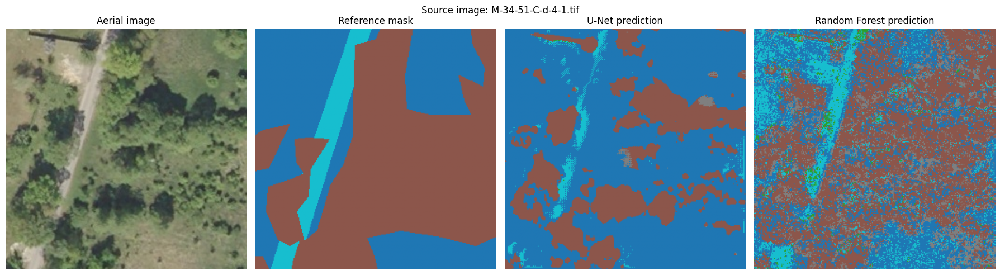
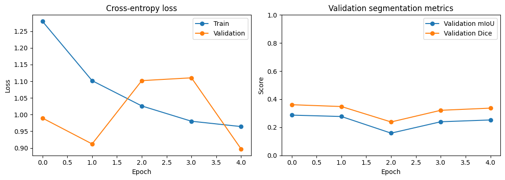

# Land-Cover Segmentation with U-Net and Random Forest

A compact remote-sensing portfolio project comparing a PyTorch U-Net semantic-segmentation model with a Random Forest pixel-classification baseline on labelled high-resolution aerial imagery from LandCover.ai.

## Project objectives

- Prepare labelled aerial imagery as image patches and segmentation masks.
- Train a U-Net model for pixel-level semantic segmentation.
- Train a Random Forest baseline using RGB pixel values.
- Compare both approaches using mean Intersection over Union (mIoU), mean Dice, and class-level precision, recall and F1-score.
- Inspect prediction maps and training curves.

## Results from the current run

| Metric | Weighted U-Net | Balanced Random Forest |
|---|---:|---:|
| Test mIoU | 0.2774 | 0.2263 |
| Test mean Dice | 0.3516 | 0.3355 |

The U-Net performed better on overall mIoU and mean Dice in this run. The Random Forest showed higher recall for several minority classes but generated many false positives. Both models struggled with building detection.

These are the actual reported results from this run, not benchmark results. The U-Net used class-weighted cross-entropy and stopped early after validation mIoU did not improve for four consecutive epochs. The Random Forest was trained using up to 30,000 sampled pixels per class.

### Prediction comparison

### Training curves

## Dataset

The notebook uses **LandCover.ai**, which provides high-resolution aerial imagery with pixel-level labels for classes including buildings, woodland, water and roads.

- Official dataset: https://landcover.ai.linuxpolska.com/
- Paper: Boguszewski et al. (2021), *LandCover.ai: Dataset for Automatic Mapping of Buildings, Woodlands, Water and Roads from Aerial Imagery*, CVPR Workshops.
- Check the dataset's current licence and terms before reuse. Do not upload the dataset itself to this repository.

## Methods

- **U-Net:** implemented in PyTorch; predicts a class for every pixel.
- **Random Forest:** scikit-learn classifier trained on sampled RGB pixel values.
- **Metrics:** mean IoU, mean Dice, class-level precision/recall/F1.
- **Environment:** Google Colab with a GPU runtime; a T4 GPU was used for the experiment.

## Repository contents

- `notebooks/`: place the final executed Colab notebook here.
- `images/`: prediction comparison and training-curve figures from the current run.
- `results.md`: concise record of metrics and interpretation.
- `requirements.txt`: core Python packages.
- `LICENSE_DATASET_NOTE.md`: dataset-use reminder.

## How to reproduce

1. Download the final notebook from Google Colab using **File → Download → Download .ipynb**.
2. Save it in `notebooks/` as `landcover_unet_random_forest.ipynb`.
3. Open the notebook in Google Colab.
4. Select a GPU runtime if available.
5. Run the cells in order. The dataset download and extraction may take time.
6. Compare the new metrics with those documented here. Update this README and `results.md` if you publish results from a different run.

## Limitations and next steps

- The dataset contains high-resolution RGB aerial imagery, not multi-year Sentinel-2 time series.
- This is a small, exploratory run with a limited patch sample and short training.
- Random patch splitting may place neighbouring patches from the same source orthophoto in both training and test sets, potentially inflating performance. A stronger evaluation should split by original source image before patch extraction.
- The Random Forest uses RGB values only, without texture, neighbourhood or spectral time-series features.
- Minority classes, particularly buildings, remain difficult to classify.
- Results should not be interpreted as evidence of production-scale land-cover mapping performance.

## Citation

Boguszewski, A., Batorski, D., Ziemba-Jankowska, N., Dziedzic, T. and Zambrzycka, A. (2021). *LandCover.ai: Dataset for Automatic Mapping of Buildings, Woodlands, Water and Roads from Aerial Imagery*. CVPR Workshops.
